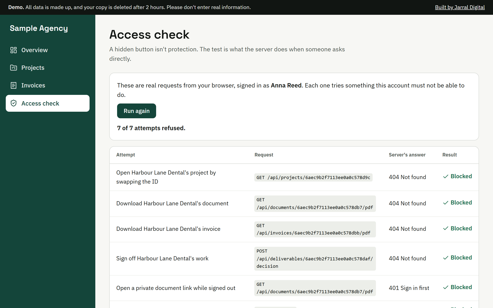

# Client portal demo

**[Try the live demo](https://portal-demo.jarraldigital.com)**, no sign-up needed.

A working client portal built with the MERN stack: MongoDB, Express, React and Node.



**This is a demo, not a real client's project.** Every company, person and figure in it is made up.

Clients follow their projects, sign off work, message the team, share files and download their documents and invoices. Agency staff see every client and invite new people. No client can see another client's work.

Version 1.1 adds password reset, two-step sign-in with an authenticator app, invitations and private file sharing.

## Why it exists

Plenty of portals look finished and still fail on the part that matters. If a portal only checks that you're logged in, and not that the file belongs to you, changing one number in a link opens another client's file. Nothing looks broken.

So this demo shows that part in the open. Sign in as a client, open **Access check**, and your browser sends real requests to the server trying to reach another client's data. You see each answer.

## Try it

| Account | What it shows |
|---|---|
| Anna Reed, Alder & Finch Accountants | A client who can sign off work |
| Tom Hale, Alder & Finch Accountants | The same client, read and message only |
| Priya Shah, Harbour Lane Dental | A different client |
| Sam Carter, Sample Agency | Staff: every client, the activity log, and branding |

1. Sign in as Anna and approve the homepage design.
2. Open **Access check** and run the checks.
3. Switch to Sam and open the **Activity log**. Anna's approval and refused attempts are there.
4. Still as Sam, open **Branding** and change the name and colour. The whole portal changes for your clients too.
5. As Sam, open **People** and invite someone. Open the **Demo inbox**, accept the invitation and choose a password. You're now signed in as the new person, with only the access the invitation gave.
6. Open **Security** and turn on two-step sign-in with any authenticator app. Sign out and back in: the password alone is no longer enough.
7. On the sign-in page, use **Forgot your password?**, then open the reset link from the Demo inbox.

**The Demo inbox** stands in for email. A real portal would send these messages; here they appear inside the demo, so nothing reaches a real mailbox.

## How access is enforced

| Check | Where in the code |
|---|---|
| Every database query is limited to the signed-in user's records | [server/lib/access.js](server/lib/access.js), `scope()` |
| Another client's record answers 404, the same as one that doesn't exist | `findOr404()` in the same file |
| Staff-only actions are refused for client accounts | [server/middleware/auth.js](server/middleware/auth.js), `requireStaff` |
| Only an approver at the client can sign off | `POST /deliverables/:id/decision` in [server/routes/projects.js](server/routes/projects.js) |
| Download links are checked like any other page | [server/routes/billing.js](server/routes/billing.js) |
| Refused attempts are logged | `audit()` in [server/lib/access.js](server/lib/access.js) |
| Reset and invitation links work once, run out, and are stored only as a hash | [server/lib/tokens.js](server/lib/tokens.js), [server/routes/auth.js](server/routes/auth.js) |
| A password reset signs out every other session | `authVersion` in [server/middleware/auth.js](server/middleware/auth.js) |
| Authenticator codes can't be reused | [server/lib/totp.js](server/lib/totp.js), [server/lib/twoFactor.js](server/lib/twoFactor.js) |
| An invited person gets the role in the invitation, nothing else | `POST /auth/invite/accept` in [server/routes/auth.js](server/routes/auth.js) |
| Uploads are checked by content, capped, and always downloaded, never shown as a page | [server/routes/uploads.js](server/routes/uploads.js) |

Also in place:

- Passwords hashed with bcrypt, and generic login errors
- Session cookies that scripts can't read, with a new session ID at each sign-in
- Rate limits on login
- Requests from other websites refused
- Every request body validated
- No caching of private answers
- A strict Content Security Policy

## Each visitor gets a private copy

The first sign-in creates a private copy of the sample data. Other visitors can't see what you type, and MongoDB deletes your copy after 2 hours. That's what `workspaceId` and `expiresAt` are for in [server/models.js](server/models.js).

## Left out on purpose

A real portal would also need these. This demo doesn't have them, because it has no real users or real money:

- Real email. Reset links and invitations go to the Demo inbox instead.
- Card payments
- Adding new client companies from the screen
- Virus scanning of uploads, and file storage outside the database. Uploads here are small, live in MongoDB, and are deleted with the visitor's copy.
- Encrypting the authenticator secrets in the database with a separate key

The `/api/demo/probes` route exists only for the Access check page. A real portal wouldn't have it.

## Run it on your computer

You need Node 22.22 or newer. You don't need a database: without `MONGODB_URI` the app uses a temporary one in memory, which downloads about 800 MB the first time.

```
npm install
npm run dev
```

Then open http://localhost:5173.

## Tests

```
npm test
```

The tests mostly check what must not happen: swapped IDs, signed-out download links, staff pages opened as a client, one visitor reaching another's copy, reused reset links and codes, a fake file with a PDF name. `tests/portal.test.js` covers version 1.0, `tests/accounts.test.js` version 1.1.

## Where things are

```
server.js              starts the app
server/config.js       settings
server/models.js       database collections
server/lib/access.js   who can see and do what: read this first
server/lib/workspace.js  creates a visitor's private copy
server/lib/totp.js     the authenticator app codes
server/lib/tokens.js   one-time links for resets and invitations
server/lib/inbox.js    the Demo inbox, where email would be sent
server/routes/         the API
server/middleware/     login checks and security
client/src/            the React app
tests/                 automated tests
```

[docs/CODE-WALKTHROUGH.md](docs/CODE-WALKTHROUGH.md) follows one request through the code, step by step.

## Built by

[Jarral Digital](https://jarraldigital.com/agencies/), who build web apps and WordPress sites for agencies, under the agency's brand. We use AI tools, including Claude Code, to build faster, and we treat what they write as a draft: see the tests.
